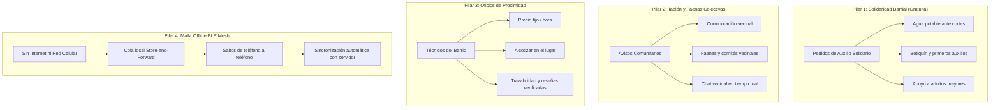

# AYNI · Red Vecinal Solidaria y Resiliencia Barrial
*Propuesta oficial para la Hackathon UTP – El Comercio 2026*

> **"Hoy por ti, mañana por mí"** — La plataforma que transforma comunidades conectando ayuda solidaria ante emergencias, organización vecinal y oficios locales de confianza, operativa incluso sin conexión a internet ni red celular mediante tecnología Bluetooth Mesh (BLE).

---

## 📌 Visión y Propósito del Proyecto

En el Perú, ante eventos imprevistos como cortes prolongados de agua potable (Sedapal), huaicos, sismos o fallas masivas de energía, las comunidades enfrentan un doble desafío: **vulnerabilidad en servicios esenciales** y **pérdida de canales de comunicación**. Al mismo tiempo, la economía barrial depende en gran medida de oficios informales (electricistas, gasfiteros, carpinteros) que carecen de mecanismos de reputación y confianza dentro de su propio vecindario.

**Ayni** no es una bolsa de trabajo tradicional ni un marketplace genérico: es una **Red de Resiliencia y Solidaridad Barrial** diseñada para fortalecer el tejido comunitario bajo dos grandes ejes:
1. **Solidaridad, faenas comunales y resiliencia offline:** Pedidos de auxilio mutuo ante emergencias, avisos comunitarios con corroboración ciudadana para frenar la desinformación, faenas colectivas y transmisión de alertas de teléfono a teléfono vía Bluetooth Mesh cuando cae internet.
2. **Economía y oficios de proximidad:** Contratación transparente de especialistas técnicos vecinos con modalidades claras (precio fijo o a cotizar en el lugar) y reputación 100% verificada tras el servicio.

---

## 🏛️ Los 4 Pilares Fundamentales de Ayni



### 1. Ayuda Solidaria Mutua (100% Gratuita)
- **Pedidos de auxilio comunitarios:** Solicitudes clasificadas en agua potable, medicinas/botiquín, electricidad, cuidado de adultos mayores, herramientas y transporte.
- **Niveles de urgencia:** Alta, media y baja, con tiempo de expiración automático (por defecto 24 horas o plazo personalizado) para mantener la información siempre vigente.
- **Sin costo monetario:** Fomenta la ayuda desinteresada entre vecinos inmediatos.

### 2. Tablón Vecinal, Corroboración Ciudadana y Faenas
- **Avisos comunitarios verificados:** Reportes sobre cortes de agua o luz, seguridad barrial y comunicados comunales.
- **Mecanismo de corroboración:** Voto comunitario donde los vecinos confirman si un aviso es real y vigente, previniendo noticias falsas o rumores.
- **Faenas comunales y trabajo colectivo:** Convocatorias para limpieza de parques, mantenimiento de áreas verdes y comités vecinales, con conteo interactivo de participantes.
- **Chat vecinal en tiempo real:** Comunicación directa estilo mensajería instantánea, con mensajes fijados por juntas directivas, modo lectura y soporte multimedia.

### 3. Oficios Vecinales de Confianza (Economía Circular)
- **Verificación de identidad:** Registro con validación de DNI o Carnet de Extranjería (CE).
- **Dos modalidades de cobro transparentes:**
  - **Precio fijo:** Tarifa cerrada o por hora en Soles (S/.), ideal para labores puntuales y estandarizadas.
  - **A cotizar en el lugar:** El técnico visita primero el domicilio para evaluar la labor y acordar el presupuesto final cara a cara.
- **Trazabilidad completa de estados:** Solicitado → Aceptado → En camino (con estimación de tiempo y medio de transporte) → En proceso en domicilio → Concluido.
- **Reputación verificada anti-fraude:** Solo los clientes que han completado un servicio pueden calificar (1 a 5 estrellas) y redactar una reseña pública.

### 4. Protocolo Offline BLE Mesh (Store & Forward)
- **Concepto de emergencia:** En sismos, cortes de fibra o apagones masivos sin señal celular, las alertas de auxilio no se pierden: se almacenan cifradas en el dispositivo móvil y se transmiten automáticamente vía Bluetooth Low Energy (BLE) a 2.4 GHz de vecino a vecino.
- **Ciclo completo de 4 etapas:**
  1. `Guardado`: Paquete sellado localmente en el almacenamiento seguro del teléfono (`OfflineEnvelope`).
  2. `Enviando`: Búsqueda activa y transmisión por radio BLE hacia terminales cercanos (alcance ~15 metros).
  3. `Recibido por vecino`: El teléfono del vecino acusa recibo y confirma la retransmisión comunitaria.
  4. `Sincronizado`: Al alcanzar un nodo o vecino con conexión, se sincroniza de forma idempotente con el servidor central (`/api/v1/sync/batch`).
- **Demostración en vivo:** Incluye un botón interactivo *"Probar malla"* en el Centro de Conectividad para que los evaluadores puedan apreciar la propagación rápida visualmente.

---

## 🎨 Innovaciones de Interfaz y Experiencia Móvil (UX)

- **Selector Inteligente de Ubicación Híbrida (`LocationAddressPicker`):**
  - Detección precisa por **GPS nativo** (*"Tu ubicación actual"*).
  - Autocompletado de direcciones en tiempo real con OpenStreetMap / Nominatim.
  - Selector interactivo arrastrable **Point-on-Map**: mapa con pin central reposicionable y geocodificación inversa para confirmación de dirección exacta.
- **Modo Oscuro Integral (Dark Theme):**
  - Soporte de alto contraste para día y noche en todas las pantallas, formularios, modales, chats y banners.
  - Conmutador rápido de tema accesible desde el Perfil y la pantalla de acceso.
- **Tutorial Interactivo Onboarding en 6 Pasos:**
  - Recorrido guiado que educa al usuario sobre la identidad no mercantil de Ayni, la corroboración de avisos, las faenas, las dos formas de cobro y el protocolo offline BLE.
- **Identidad Visual Oficial y Cero Emojis:**
  - Logotipo oficial de anillos entrelazados Ayni implementado en iconos de aplicación (`ic_launcher`) en todas las densidades de Android (`mdpi` a `xxxhdpi`), pantallas Splash nativas y favicon web.
  - Diseño 100% limpio y profesional: sin emojis en la UI, utilizando exclusivamente iconos vectoriales SVG de Lucide Icons.

---

## 🛠️ Stack Tecnológico

| Capa | Tecnologías |
|---|---|
| **Frontend Móvil & Web** | React 19, TypeScript, Vite, Capacitor 8 (Android nativo), Leaflet / OpenStreetMap, Lucide Icons |
| **Backend API** | Python 3.12+, FastAPI, SQLAlchemy, Pydantic v2, Uvicorn, OAuth2 con JWT |
| **Bases de Datos** | SQLite (desarrollo local y pruebas) / PostgreSQL con PostGIS (despliegue en producción) |
| **Arquitectura Offline** | LocalStorage / SQLite encriptado, arquitectura Store & Forward, sincronización idempotente por lotes |

---

## 🚀 Guía de Instalación y Ejecución

### Prerrequisitos
- **Node.js** v20 o superior y **npm**.
- **Python** 3.10 o superior.
- **Android Studio** y Android SDK (opcional, solo para compilar el APK nativo en emulador o dispositivo físico).

---

### 1. Frontend Web y Móvil (React + Capacitor)

```bash
# 1. Clonar el repositorio
git clone https://github.com/KingBathos/Ayni.git
cd Ayni

# 2. Instalar dependencias
npm install

# 3. Iniciar el servidor web de desarrollo
npm run dev
# Abrirá la aplicación en http://localhost:5173
```

#### Compilación y Sincronización con Android Nativo:
```bash
# Compilar frontend para producción y sincronizar con Android
npm run sync:mobile

# Abrir el proyecto en Android Studio (opcional)
npx cap open android

# O compilar directamente el APK Debug desde la terminal
cd android
./gradlew assembleDebug      # En Linux / Mac
gradlew.bat assembleDebug    # En Windows PowerShell
# El archivo APK se generará en: android/app/build/outputs/apk/debug/app-debug.apk
```

---

### 2. Backend API (FastAPI)

```bash
# 1. Entrar a la carpeta backend
cd backend

# 2. Crear y activar entorno virtual
python -m venv .venv

# En Windows PowerShell:
.venv\Scripts\Activate.ps1

# En Linux / Mac:
source .venv/bin/activate

# 3. Instalar dependencias del backend
pip install -r requirements.txt

# 4. Iniciar el servidor API
uvicorn app.main:app --reload --host 0.0.0.0 --port 8000
```

- **Documentación Interactiva Swagger / OpenAPI:** [`http://127.0.0.1:8000/docs`](http://127.0.0.1:8000/docs)
- **Documentación ReDoc:** [`http://127.0.0.1:8000/redoc`](http://127.0.0.1:8000/redoc)
- **Health Check:** [`http://127.0.0.1:8000/health`](http://127.0.0.1:8000/health)

---

## 👥 Usuarios de Prueba Precargados (Demo)

El backend y frontend incluyen datos semilla (*seed*) listos para pruebas con credenciales preconfiguradas:

| Nombre | Correo | Rol / Especialidad | Barrio | Contraseña |
|---|---|---|---|---|
| **María Quispe** | `maria@ayni.pe` | Usuaria vecinal / Cliente | San Borja Central | `ayni1234` |
| **José Ramírez** | `jose@ayni.pe` | Electricista certificado (Oficio) | San Borja / Malachowsky | `ayni1234` |
| **Rosa Flores** | `rosa@ayni.pe` | Gasfitera y saneamiento (Oficio) | San Borja Norte | `ayni1234` |
| **Pedro Castillo** | `pedro@ayni.pe` | Carpintero y cerrajería (Oficio) | Limatambo | `ayni1234` |
| **Admin Ayni** | `admin@ayni.pe` | Administrador / Moderación | General | `ayni1234` |

*Nota: La aplicación cuenta con modo demo automático para registro rápido con DNI peruano de 8 dígitos.*

---

## 📂 Estructura del Proyecto

```
Ayni/
├── android/                   # Proyecto nativo Android (Capacitor)
│   ├── app/src/main/res/      # Iconos adaptativos (mipmap) y Splash screens nativas
│   └── app/build/outputs/apk/ # Directorio de salida del APK compilado
├── backend/                   # API REST en Python FastAPI
│   └── app/
│       ├── main.py            # Servidor FastAPI y middlewares
│       ├── models.py          # Modelos de base de datos SQLAlchemy
│       ├── schemas.py         # Validación de esquemas Pydantic v2
│       ├── seed.py            # Generador de datos semilla vecinales
│       └── routers/           # Endpoints modulares (help, community, services, sync...)
├── public/                    # Favicon oficial e isotipo SVG Ayni
├── src/                       # Aplicación React 19 + TypeScript
│   ├── App.tsx                # Orquestador principal, navegación y gestión de estado
│   ├── App.css                # Sistema de diseño, temas claro/oscuro y componentes móviles
│   ├── types.ts               # Definiciones completas de tipos TypeScript
│   ├── api.ts                 # Cliente HTTP con detección y almacenamiento offline
│   ├── LocationAddressPicker.tsx # Selector de dirección híbrida GPS + Mapa + Autocompletado
│   └── InteractiveTutorial.tsx   # Tutorial interactivo de 6 pasos (Onboarding)
├── capacitor.config.ts        # Configuración del contenedor nativo móvil
├── package.json               # Dependencias y scripts de construcción
└── README.md                  # Documentación oficial del proyecto
```

---

## 🏆 Créditos y Reconocimientos

Desarrollado con dedicación para la **Hackathon UTP – El Comercio 2026**.  
*Ayni: Fortaleciendo comunidades resilientes, solidarias y conectadas.*
